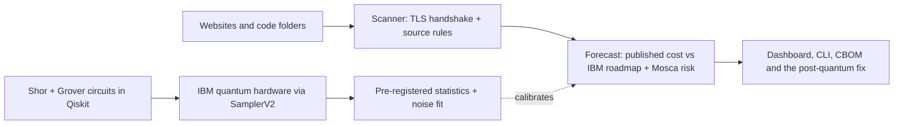
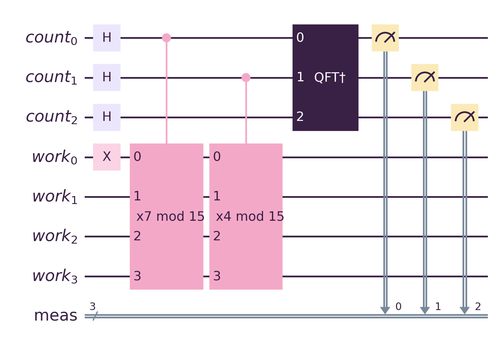
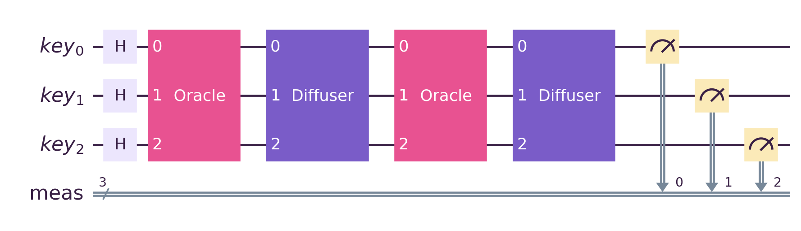
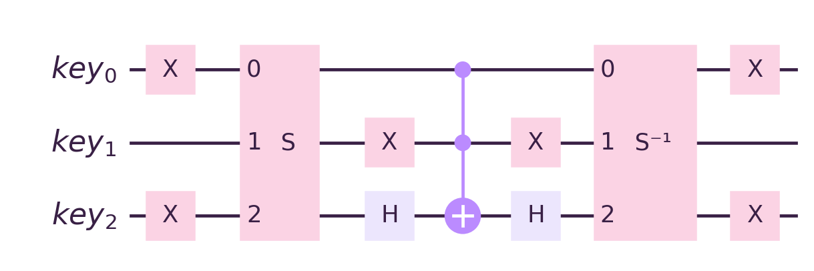
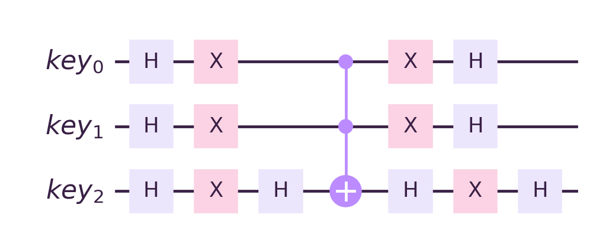

<div align="center">

# Straw Hat Pirates

**VTU-QFF-HC-0106** &nbsp;|&nbsp; Tier: **Online**

</div>

---

<div align="center">

| | |
| :--- | :--- |
| **Team** | Straw Hat Pirates |
| **Team ID** | VTU-QFF-HC-0106 |
| **Tier** | Online |
| **Repository** | [vtu-hc-straw-hat-pirates](https://github.com/vtu-qiskit-fall-fest-2026/vtu-hc-straw-hat-pirates.git) |
| **Organisation** | [vtu-qiskit-fall-fest-2026](https://github.com/vtu-qiskit-fall-fest-2026) |
| **Event** | VTU-QFF Hackathon — VTU-Qiskit Fall Fest 2026 |

</div>

---

## 📌 Table of Contents

- [Team Members](#-team-members-github-ids)
- [Problem Statement](#-problem-statement)
- [Proposed Solution](#-proposed-solution)
- [Approach & Architecture](#-approach--architecture)
- [Tech Stack](#-tech-stack)
- [Project Structure](#-project-structure)
- [How to Run](#-how-to-run)
- [How to Push Code](#-how-to-push-code)
- [Submission Checklist](#-submission-checklist)
- [Resources](#-resources)
- [License](#-license)

---

## 👥 Team Members (GitHub IDs)

> Members are added to this repository as **collaborators** and must accept the
> GitHub invitation before they can push. Add your GitHub username below.

| # | Name | GitHub Username | Role |
| :-- | :--- | :--- | :--- |
| 1 | Raunak Kumar Gupta | [@Raunakg2005](https://github.com/Raunakg2005) | Team Lead |
| 2 | Krish Jain | [@krish2006-jain](https://github.com/krish2006-jain) | Developer |

<!--
Optional: add a plain list instead of the table above.
- @username1
- @username2
-->

---

## ❓ Problem Statement

<!--
State the problem you are solving. Be specific: what is broken or missing,
who experiences it, and why does it matter. Link to the official problem
statement from the brief if one applies.
-->

**Problem:** Shor's algorithm breaks the RSA and elliptic-curve cryptography behind today's logins, payments and
signatures, and attackers can already record encrypted traffic to decrypt it later ("harvest now, decrypt later").
Organisations know this, but can't answer the questions that drive decisions: **which** of my systems break first,
**in what year**, and **is the data I send today** already at risk? Inventory tools list where cryptography is used;
they don't turn that list into a timeline, a priority order or a proof.

**Why it matters:** NIST's draft transition plan (IR 8547) retires RSA and elliptic-curve cryptography by **2035**,
and migrations take years, so data with a long shelf life (health, finance, identity) is exposed today. Without a
dated, evidence-backed answer, teams either panic or postpone.

**Track / Category:** Online · Track 1 · Quantum Cryptography & Security

---

## 💡 Proposed Solution

<!--
Describe your solution. Keep it concrete: the core idea, the user flow, and
the quantum/ML technique you are applying.
-->

<div align="center">

### Q-Day Time Machine

[](https://youtu.be/nhXP6QLFjoU)

**[▶ Watch the demo video](https://youtu.be/nhXP6QLFjoU)** (6:44, product demo plus a technical deep-dive) &nbsp;·&nbsp;
**[Presentation (PPTX)](docs/Q-Day_Time_Machine_VTU-QFF-HC-0106.pptx)** &nbsp;·&nbsp;
**[Documentation](https://qday-time-machine.readthedocs.io/)** &nbsp;·&nbsp;
**[Full hardware results](docs/RESULTS.md)**

[](https://github.com/vtu-qiskit-fall-fest-2026/vtu-hc-straw-hat-pirates/actions/workflows/ci.yml)
[](https://pypi.org/project/qday-time-machine/)

</div>

**Solution:** Q-Day Time Machine scans websites and source code for quantum-vulnerable cryptography, forecasts the
year each algorithm breaks by comparing published attack costs with IBM's quantum roadmap, proves the attacks by
running Shor's and Grover's algorithms on real IBM quantum computers, and demonstrates the NIST post-quantum fix,
all in one dashboard and one command-line tool.

**Key idea:** A break year is the first year IBM's roadmap provides **both** the logical qubits **and** the gate
count a published attack needs; we then measure the real error rate on IBM hardware and carry it through a
surface-code model to what RSA-2048 would actually take.

**Why this works:** It turns a cryptography inventory into a dated, prioritised plan (Mosca's inequality decides
what is already at risk), and backs the forecast with evidence: attacks run on three IBM quantum computers with pass
rules fixed in code before the runs, circuits that never encode the answer, and a second independent simulator
checking every circuit.

| Step | What it does | Quantum / IBM piece |
| :--- | :--- | :--- |
| **1. Scan** | Reads live TLS endpoints (certificate key, CA key, key-exchange group, cipher) and source code in eight languages | Detects the hybrid post-quantum group **X25519MLKEM768** |
| **2. Inventory** | Exports a **CycloneDX 1.6 Cryptography Bill of Materials** with a quantum-security level per algorithm | CBOM format (from IBM Research) |
| **3. Time Machine** | A year slider compares each algorithm's published **logical-qubit and Toffoli-gate cost** with **IBM's roadmap** (Starling 2029, Blue Jay 2033+) | IBM fault-tolerant roadmap |
| **4. Risk** | **Mosca's inequality** and a harvest-now window: which recorded traffic becomes readable, and when | — |
| **5. Prove it** | Scaled-down **Shor** (factors 15 and 21) and **Grover** (recovers a toy cipher key), run on simulators and **real IBM quantum computers**, stepped through gate by gate | Qiskit, Aer, Qiskit Runtime `SamplerV2`, quantum-debugger |
| **6. Migrate** | Live hybrid **X25519 + ML-KEM-768** key exchange (FIPS 203) and **ML-DSA-65** signatures (FIPS 204) beside RSA-2048 and ECDSA P-256 | NIST post-quantum standards |

**At a glance**

| | |
| :--- | :--- |
| **Hardware proof** | **45 / 45** validation tests passed on **ibm_fez, ibm_kingston and ibm_marrakesh**; Shor factored 15 = 3 × 5 on every machine (24 / 24 strict tests). 8 jobs, 163 s of QPU time, every job ID listed. |
| **Our finding** | We measured the error per two-qubit gate on all three machines: **~3 × 10⁻³ on the best qubits**, three times the published RSA-2048 estimate's assumption, so the attack would need **~4 million** physical qubits rather than under 1 million. A compiler's default qubits can sit **above the error-correction threshold**. |
| **Engineering** | **1,002 tests**, 96% line coverage, CI on Python 3.11 and 3.12 with a secret scan, Docker image, `qday` CLI on PyPI that can gate CI. |
| **Our library** | [quantum-debugger](https://pypi.org/project/quantum-debugger/) re-simulates every attack circuit as an independent check on Qiskit and powers a gate-by-gate step-through view. |

**Screenshots.** The landing page flies through IBM's roadmap: each ring is one year; the outer ring is RSA-2048,
the inner ring ECDSA P-256, green while safe and pink once breakable.

<p align="center">
  
  
</p>

<table>
<tr>
<td width="50%" valign="top"><b>1 · Scan</b>: our own website uses post-quantum key exchange, but its ECDSA certificate is breakable; code findings are sorted by what to fix first.<br><br></td>
<td width="50%" valign="top"><b>2 · Time Machine</b>: the best quantum computer each year against what each attack needs.<br><br></td>
</tr>
<tr>
<td valign="top"><b>3 · Prove it</b>: Shor's algorithm factoring 15 on ibm_marrakesh; the pink bars are the correct answers.<br><br></td>
<td valign="top"><b>Strict validation</b>: pre-registered pass rules across three IBM quantum computers.<br><br></td>
</tr>
<tr>
<td valign="top"><b>Inside the circuit</b>: quantum-debugger pauses Grover's attack after each oracle and diffuser.<br><br></td>
<td valign="top"><b>4 · Migrate</b>: a working hybrid ML-KEM handshake and ML-DSA signatures beside RSA and ECDSA.<br><br></td>
</tr>
<tr>
<td colspan="2" valign="top"><b>Hardware-calibrated Q-Day</b>: the error rate we measured on IBM's machines, carried through to RSA-2048.<br><br></td>
</tr>
</table>

**Limitations.** The attacks break **toy** instances (N = 15 and 21; 3–4-bit keys), not production keys. Break
years rest on published estimates and IBM's stated roadmap; after 2033 the growth scenario is an explicit
extrapolation, and newer elliptic-curve estimates are lower than the 2017 bound used here. The code scanner is
pattern-based: findings are leads to review, not proof of reachability. Only scan systems you own or are
authorised to test.

---

## 🧩 Approach & Architecture

<!--
Walk through how it works. A simple pipeline diagram in text or Mermaid is ideal.
-->



1. **Input** — website hostnames (live TLS handshakes) and source-code folders; for the attacks, the number to
   factor (N = 15 or 21) and a known plaintext–ciphertext pair for the key search
2. **Preprocessing** — hostnames validated (RFC 1123), the certificate, key-exchange group and cipher read with
   Python `ssl` and `openssl s_client`; code matched against per-language rules; every finding normalised into an
   asset (algorithm, purpose, location) and exported as a CycloneDX 1.6 CBOM
3. **Quantum core** — Shor's order finding (quantum phase estimation, modular multipliers synthesised for any
   constant, inverse QFT) and Grover key search (cipher oracle + diffuser), transpiled for IBM hardware and run as
   one `SamplerV2` job per machine
4. **Post-processing** — continued fractions and gcd turn Shor's measurements into factors; Wilson intervals,
   binomial tests and the strict pass rules score every run; a depolarising fit of the Grover runs gives the error
   per two-qubit gate
5. **Output** — findings with risk level, break year and the post-quantum replacement; the year-by-year Time
   Machine; the hardware evidence and the hardware-calibrated forecast; a working ML-KEM / ML-DSA migration demo

More detail: [docs/ARCHITECTURE.md](docs/ARCHITECTURE.md) and the [methods page](https://qday-time-machine.readthedocs.io/en/latest/methods/).

### Shor's algorithm (order finding) — `qday/quantum/shor.py`
- Quantum phase estimation over `f(x) = aˣ mod N`: counting qubit *j* controls **multiply by a^(2^j) mod N**,
  then an inverse QFT; continued fractions give the period *r*, and `gcd(a^(r/2) ± 1, N)` the factors.
- The multiplier is **synthesised for any constant**, so the circuit never encodes the answer. For N = 15 every
  unit is ±2ᵏ, so multiplication is a bit rotation plus NOT (173 two-qubit gates on hardware); other N use a
  permutation unitary (simulator scale). Every multiplier is checked on every input.

<p align="center">
  
</p>
<p align="center"><sub>Shor's order finding for N = 15, a = 7, as run on ibm_fez, ibm_kingston and ibm_marrakesh. Counting qubit <i>j</i> controls multiply by 7^(2^j) mod 15 (×7, ×4; ×1 is the identity and is left out), then the inverse QFT. Drawn by <code>scripts/draw_circuits.py</code> from the same code.</sub></p>

### Grover key search — `qday/quantum/grover.py`
- Toy cipher `E_k(p) = S(p ⊕ k)` with a nonlinear S-box (PRESENT's 4-bit S-box; 3-bit on hardware). The
  oracle runs the cipher on every key at once and flips the phase of keys with `E_k(p) = c`; the diffuser
  reflects about the mean.
- About (π/4)·√(2ⁿ) oracle calls instead of up to 2ⁿ trials: the square-root speed-up that halves symmetric
  key strength (why AES-256 is advised over AES-128). Success follows `sin²((2i+1)θ)`, including overshoot.

<p align="center">
  
</p>
<p align="center">
  
  
</p>
<p align="center"><sub>Grover key search on a 3-bit key, 2 iterations, as run on hardware (top). The oracle (left) XORs in the plaintext, applies the S-box, flips the phase where the output equals the known ciphertext, then uncomputes; the diffuser (right) reflects every amplitude about the mean.</sub></p>

### Independent check with quantum-debugger — `qday/quantum/debug.py`
[quantum-debugger](https://pypi.org/project/quantum-debugger/) is our team lead's open-source circuit debugger.
- **Second simulator:** every Shor and Grover circuit is re-simulated gate by gate by its own state-vector
  engine. It agrees with Qiskit on every Shor base of 15 and every Grover key tested (largest difference
  3 × 10⁻¹³). Conversion is exact or refused: it never silently drops a gate.
- **Step-through:** the dashboard pauses Grover after every oracle and diffuser and shows each key's amplitude:
  the oracle flips the secret key's sign, and the diffuser turns that into probability.

### Results on IBM quantum hardware

**8 jobs on 3 IBM quantum computers, 132 circuits, 163 seconds of QPU time.** Every number below is recomputed from
the raw counts in [`results/`](results/) by `scripts/summarize_results.py`, and a test fails if the tables drift
from the data. Full tables with 95% intervals, the noise-model prediction and the ideal value for every circuit:
**[docs/RESULTS.md](docs/RESULTS.md)**.

| Run | Backend | Job ID | QPU seconds |
| :--- | :--- | :--- | ---: |
| First run | `ibm_marrakesh` | `dbc82qvi0auc73ducseg` | 8 |
| Validation suite | `ibm_fez` · `ibm_kingston` · `ibm_marrakesh` | `dbc8tqgc77vs7385p33g` · `dbc8tffi0auc73duef60` · `dbc8tm7i0auc73duefl0` | 63 |
| Strict suite | `ibm_fez` · `ibm_kingston` (+ repeat) · `ibm_marrakesh` | `dbc9rls24mrc73cj63jg` · `dbc9rfvi0auc73dugd5g` · `dbc9rg0c77vs7385qv20` · `dbc9ripgv2cc73e9t4v0` | 92 |

**Validation suite** (`scripts/hardware_suite.py`): 17 circuits × 4,000 shots per machine: Shor for every base of
15, Grover for all 8 three-bit keys, and two negative controls that must fail. A test passes only if its whole 95%
Wilson interval is above the random / noise baseline.

| | Random / noise baseline | Ideal | Noise model | `ibm_fez` | `ibm_kingston` | `ibm_marrakesh` |
| :--- | ---: | ---: | ---: | ---: | ---: | ---: |
| Shor N = 15, a = 7 (173 two-qubit gates) | 37.5% | 75.0% | 70.1% | 67.6% ± 1.5 | 62.3% ± 1.5 | 69.9% ± 1.4 |
| Shor, all 6 bases (factors 3 × 5 found) | | | | 7 / 7 | 7 / 7 | 7 / 7 |
| Grover, 2 iterations (143 two-qubit gates) | 12.5% | 94.5% | 71.7–73.2% | 56–64% | 59–68% | 38–45% |
| Grover, all 8 keys recovered | | | | 8 / 8 | 8 / 8 | 8 / 8 |
| Both negative controls behave | | | | ok | ok | ok |

**45 / 45 tests pass; the largest p-value is 7.5 × 10⁻²²⁰.** The four most frequent Shor outcomes are exactly
the ideal peaks y = 0, 2, 4, 6.

**Strict suite** (`scripts/hardware_strict.py`): six rules fixed in code before the runs (criteria `strict-v1` in
`qday/quantum/validation.py`): a Bonferroni-corrected signal test, the right answer must dominate, at least half
the ideal signal must survive, Grover's iteration curve must match theory (Pearson r ≥ 0.9), other qubit
placements must also pass, and a repeat job must agree. Grover secrets were drawn blind at submit time.

| | `ibm_kingston` | `ibm_fez` | `ibm_marrakesh` |
| :--- | :---: | :---: | :---: |
| Every rule, all 14 tests | **14 / 14** | 11 / 14 | 9 / 14 |
| Shor | 8 / 8 | 8 / 8 | 8 / 8 |
| Grover | 6 / 6 | 3 / 6 | 1 / 6 |
| Grover curve vs theory (r) | 0.99 | 0.97 | 0.90 |
| Repeat job agrees | 19 / 19 circuits | not run | not run |

**Shor passed 24 / 24 strict tests; Grover passed 10 / 18.** Every Grover run beat random guessing. All 8
failures are on the fidelity rule (less than half the ideal signal survived), and the 4 on `ibm_marrakesh`'s
default qubits also missed the dominance rule.

### What real hardware taught us

1. **Where a circuit runs matters as much as what it is.** On `ibm_marrakesh` the compiler placed Grover on
   qubits 33–35, where it reached 22%; the same circuit on qubits 110–112 reached 64% and passed every rule.
   Measured as error per two-qubit gate, that is **1.6 × 10⁻²** versus **3.3 × 10⁻³** on one chip.
2. **The noise model was optimistic.** Qiskit's `fake_marrakesh` predicted about 72% for Grover; the real
   `ibm_marrakesh` gave 38–45%. Its calibration snapshot matched Shor well (70–72% predicted, 69–70% measured).
3. **Gate count alone does not predict success.** Shor N = 15 keeps ~70% of its 75% ideal through 177 two-qubit
   gates, while Grover drops to 38–68% through 143. In Shor N = 15 most gates act on the work register, whose
   errors barely reach the measured counting qubits; Grover measures every qubit it touches. So Shor-15 looking
   good is not evidence that Shor scales, and we use Grover to measure noise.
4. **The results are reproducible.** A second, identical `ibm_kingston` job agreed with the first on all 19
   circuits (chi-square p > 0.001 each).
5. **Toy scale is a hard wall today.** N = 21 compiles to ~6,500 two-qubit gates (N = 15 needs 173); at the error
   rate we measured it would succeed about 2 times in a billion, so we ran it on the simulator only.

### Hardware-calibrated Q-Day

The published RSA-2048 estimate assumes an error of 10⁻³ per operation. We measured ours. Each Grover run's
output is fitted as the ideal distribution mixed with uniform noise, `P = F·I + (1 − F)·U`, giving an effective
error per two-qubit gate `ε = 1 − F^(1/g)` (readout included, so an upper bound). We then carry `ε` through a
surface-code model to the resources RSA-2048 would need (`qday/forecast/calibrated.py`).

| Machine | Best qubit set | Error per 2-qubit gate | Worst qubit set | Error |
| :--- | :--- | ---: | :--- | ---: |
| `ibm_fez` | 8, 9, 10 | 3.1 × 10⁻³ | 85, 86, 87 | 6.2 × 10⁻³ |
| `ibm_kingston` | 148, 149, 150 | 3.7 × 10⁻³ | 91, 92, 98 | 4.3 × 10⁻³ |
| `ibm_marrakesh` | 110, 111, 112 | 3.3 × 10⁻³ | 33, 34, 35 | **1.6 × 10⁻² (above threshold)** |

| At an error of | Surface-code distance | Physical qubits for RSA-2048 | Without error correction |
| :--- | ---: | ---: | :--- |
| 1.0 × 10⁻³ (published assumption) | 27 | under 1 million | needs 6 × 10⁷× lower error |
| **3.1 × 10⁻³ (our best measured)** | 55 | **~4.1 million** | needs 2 × 10⁸× lower error |
| 4.2 × 10⁻³ (our median) | 75 | ~7.7 million | needs 2 × 10⁸× lower error |
| 1.6 × 10⁻² (marrakesh qubits 33–35) | — | impossible: above the ~1% threshold | — |

**Our finding:** the best qubits on all three machines agree at about **3 × 10⁻³**, three times worse than the
published estimate assumes, so breaking RSA-2048 on today's qubits would take roughly **4× as many physical
qubits** (about 4 million rather than under 1 million). The qubits a compiler picks by default can sit **above the
error-correction threshold**, where no amount of hardware helps. Q-Day therefore depends on error rates falling,
and on choosing good qubits, as much as on qubit counts. The Time Machine's forecast uses the published figures;
this section shows how far today's measured hardware is from them.

How today's error rate scales from our circuits to RSA-2048, without error correction:

| Circuit | Two-qubit gates | Chance of an error-free run at 3.1 × 10⁻³ |
| :--- | ---: | ---: |
| Grover, 1 iteration (ran on hardware) | 71 | 80% |
| Grover, 2 iterations (ran on hardware) | 143 | 64% |
| Shor N = 15 (ran on hardware) | 173 | 59% |
| Shor N = 21 (simulator only) | ~6,500 | 2 × 10⁻⁹ |
| RSA-2048 (Gidney 2025) | ~3.9 × 10¹⁰ | 10^(−5 × 10⁷) |

*Model:* surface code `p_L = 0.1 (ε / 0.01)^((d+1)/2)` with ~2d² physical qubits per logical qubit, 1,399 logical
qubits for under a week at 1 µs per round. It is simpler than the paper's, so physical qubits are scaled from the
paper's "under one million" at its assumed 10⁻³. Toffoli gates count as 6 CNOTs.

### Forecast — published attack cost vs IBM's roadmap

| Target | Logical qubits | Toffoli gates | IBM roadmap only | Roadmap + continued growth (hypothetical) |
| :--- | ---: | ---: | :--- | :--- |
| RSA-2048 (Gidney 2025) | 1,399 | 6.5 × 10⁹ | 2033: enough qubits, not enough operations | breakable ≈ **2037** |
| ECDSA P-256 (Roetteler 2017, upper bound) | 2,330 | 1.3 × 10¹¹ | not breakable on the roadmap | breakable ≈ **2042** |

### Security and production hardening

- **Input validation:** hostnames are checked against RFC 1123 before use, blocking argument injection into
  `openssl s_client` (for example a "host" of `-proxy evil:8080`).
- **Scanner limits:** no symlink following, binary files skipped, per-file and file-count caps.
- **Certificate verification on by default**; `--insecure` only for internal self-signed endpoints.
- **Secrets:** the IBM key is read at runtime from `.env`, which is git-ignored and excluded from the image.
- **Container:** non-root user and a health check. **CI:** lint with security rules, the full offline suite, a
  strict docs build and a secret scan.

---

## 🛠️ Tech Stack

| Layer | Technology |
| :--- | :--- |
| Language | Python 3.11+ |
| Quantum SDK | Qiskit `>=2.1`, Qiskit Aer, Qiskit IBM Runtime (`SamplerV2`) |
| Quantum hardware | IBM Quantum `ibm_fez`, `ibm_kingston`, `ibm_marrakesh` |
| Simulation | AerSimulator (ideal and the `fake_marrakesh` noise model), [quantum-debugger](https://pypi.org/project/quantum-debugger/) `>=1.1` as a second simulator |
| Post-quantum crypto | kyber-py (ML-KEM-768, FIPS 203), dilithium-py (ML-DSA-65, FIPS 204), cryptography (X25519, HKDF, AES-GCM) |
| Statistics | NumPy, SciPy (Wilson intervals, binomial and chi-square tests) |
| Dashboard | Streamlit, Plotly, pandas |
| Landing page | three.js, GSAP, Lenis |
| Server | aiohttp: landing page and dashboard on one port |
| Quality | pytest, Hypothesis, ruff (with security rules), GitHub Actions, Docker |
| Docs and packaging | MkDocs Material on Read the Docs, PyPI package `qday-time-machine` |
| Environment | VS Code, `venv` |
| Version control | Git + GitHub |

---

## 📁 Project Structure

```text
vtu-hc-straw-hat-pirates/
├── README.md              # This file
├── DEMO_VIDEO.md          # YouTube link to the demo video
├── requirements.txt       # Python dependencies
├── pyproject.toml         # Package metadata and the `qday` command
├── .gitignore
├── app.py                 # Streamlit dashboard: Scan · Time Machine · Prove it · Migrate · Sources
├── serve.py               # One-port server: landing page at /, dashboard at /app/
├── landing/               # three.js landing page and its build script
├── qday/
│   ├── cli.py             # `qday` command-line tool
│   ├── safety.py          # Hostname / port validation
│   ├── scanner/           # TLS profile, source-code rules, CBOM export
│   ├── forecast/          # Published estimates, IBM roadmap, risk (Mosca), hardware-calibrated forecast
│   ├── quantum/           # Shor, Grover, IBM runner, statistics, strict criteria, quantum-debugger check
│   └── migrate/           # Hybrid X25519 + ML-KEM-768, ML-DSA-65
├── scripts/               # IBM hardware runs, summarize_results.py, draw_circuits.py
├── results/               # Raw hardware counts and analysed results
├── samples/legacy_app/    # Deliberately vulnerable code for the scanner demo
├── tests/                 # 1,002 tests
├── docs/                  # Presentation (PPTX), RESULTS.md, USER_GUIDE.md, ARCHITECTURE.md, circuits, screenshots, docs site
├── Dockerfile             # Production image
└── .github/workflows/     # CI: lint, tests on Python 3.11 and 3.12, docs build, secret scan
```

---

## 🚀 How to Run

### Prerequisites

- Python 3.11 or newer
- [Git](https://git-scm.com/downloads)
- A GitHub account (you need collaborator access to this repo)
- OpenSSL 3.x on the PATH (lets website scans report the negotiated key-exchange group)

### 1. Clone the repository

```bash
git clone https://github.com/vtu-qiskit-fall-fest-2026/vtu-hc-straw-hat-pirates.git
cd vtu-hc-straw-hat-pirates
```

### 2. Create a virtual environment

```bash
python3 -m venv .venv
source .venv/bin/activate        # Linux / macOS
# .venv\Scripts\activate         # Windows (PowerShell)
```

### 3. Install dependencies

```bash
pip install --upgrade pip
pip install -r requirements.txt
pip install -e .                 # adds the `qday` command
```

### 4. Run

```bash
python serve.py
```

Open **http://localhost:8501/** for the landing page; **Launch the app** opens the dashboard at `/app/`. No IBM
account is needed: the hardware results are included in [`results/`](results/).

Or use the command line (also on PyPI: `pip install qday-time-machine`):

```bash
qday scan --host example.com --path ./src     # findings, risk, break year and the fix
qday scan --path ./src --fail-on critical     # exits 1 on critical findings: use it as a CI gate
qday cbom --path ./src -o cbom.json           # CycloneDX 1.6 cryptography bill of materials
qday forecast RSA-2048 --scenario roadmap     # requirements and first break year
qday shor --N 15 --a 7                        # run Shor (aer, fake_marrakesh or ibm_<name>)
qday grover --bits 3 --secret 6               # run Grover
qday pqc                                      # hybrid X25519 + ML-KEM-768 handshake
```

**Docker:** `docker build -t qday . && docker run -p 8501:8501 qday`

**Run on IBM hardware yourself (optional):** copy `.env.example` to `.env`, add your IBM Quantum API key, then run
`python scripts/hardware_suite.py submit --backend ibm_kingston`. `.env` is git-ignored and never baked into the
Docker image.

Every option, the dashboard walkthrough, configuration and deployment: **[docs/USER_GUIDE.md](docs/USER_GUIDE.md)**.

### 5. Run the tests

```bash
pytest -q -m "not network and not hardware"   # the offline suite
pytest -m network                             # 2 live checks against our own site
```

**1,002 tests, 96% line coverage.**

| Type | Tests | What it proves |
| :--- | ---: | :--- |
| Exhaustive quantum | 272 | Every modular multiplier on every input; Shor for every base of 15 and 21; Grover for every key against the exact sin² law |
| Forecast and risk | 193 | Exact paper values; the roadmap for every year and scenario; the full Mosca truth table |
| Security and robustness | 94 | 30 hostile hostnames rejected; binary, huge and non-UTF-8 files; symlink loops |
| TLS integration | 72 | Real handshakes with RSA, ECDSA and Ed25519 certificates on a local server |
| quantum-debugger integration | 67 | Every Shor base and Grover key agrees with Qiskit; the step-through matches theory |
| Scanner rules | 58 | Must-detect and must-not-misfire cases across eight languages |
| Post-quantum | 35 | ML-KEM / ML-DSA round trips; tampered ciphertexts and signatures rejected |
| CLI | 28 | Outputs, `--fail-on` exit codes, CBOM export, bad input |
| Statistics and strict criteria | 27 | Pass rules accept good data and reject noise |
| Golden results | 26 | Every hardware number in this README recomputed from the raw counts |
| Config and runner | 26 | Credential handling (the token is never printed), backend selection |
| Dashboard (AppTest) | 25 | The real dashboard driven headlessly: every tab, bad inputs, the step-through, the calibrated forecast |
| Noise calibration | 24 | The estimator recovers known noise and its intervals cover the truth; the surface-code model; the README's numbers |
| Property-based (Hypothesis) | 20 | Thousands of generated cases: factors multiply to N, intervals contain the rate |
| Web server | 16 | Landing at `/`, dashboard at `/app/`: websockets, large messages, dashboard down |
| Results document and packaging | 8 | `docs/RESULTS.md` matches the raw counts; the PyPI metadata and description |
| Performance | 4 | 1,500-file scan in under 15 s; 10,000 assets assessed in under 3 s |
| Live network (opt-in) | 2 | Our own site: post-quantum key exchange but an ECDSA certificate |

---

## 🔁 How to Push Code

> Full walkthrough: **[Git & Collaboration Handbook](../vtu-hc-guide-git-and-collaboration)** — collaboration
> workflow, branches, pull requests, reviews and conflict resolution.

### Configure Git (first time only)

```bash
git config --global user.name  "Your Name"
git config --global user.email "you@example.com"
```

### Everyday workflow

```bash
# 1. Get the latest changes
git checkout main
git pull origin main

# 2. Create a branch for your work
git checkout -b feature/my-task

# 3. Commit your work
git add .
git commit -m "feat: add variational circuit for the search problem"

# 4. Push the branch
git push -u origin feature/my-task

# 5. Open a Pull Request on GitHub and request a review
#    https://github.com/vtu-qiskit-fall-fest-2026/vtu-hc-straw-hat-pirates/compare/main...feature/my-task

# 6. After approval, merge into main
git checkout main
git pull origin main
git branch -d feature/my-task
```

### Commit message convention

| Prefix | Meaning |
| :--- | :--- |
| `feat:` | New feature |
| `fix:` | Bug fix |
| `docs:` | Documentation only |
| `test:` | Adding or fixing tests |
| `refactor:` | Code restructure, no behaviour change |
| `chore:` | Build/config/dependency changes |

### Useful commands

```bash
git status              # what changed
git log --oneline -10   # recent commits
git diff                # review changes before committing
git stash               # shelve changes temporarily
git pull --rebase       # update your branch on top of main
```

### Collaborating on the same repo

- **Never push directly to `main`** — open a Pull Request.
- **Pull before you push** to avoid rejected commits.
- **Commit often** with clear messages.
- **Resolve conflicts** locally: `git pull --rebase`, fix the files, then `git add` + `git rebase --continue`.
- **Ask for a review** before merging — a second pair of eyes catches bugs fast.

---

## ✅ Submission Checklist

- [x] Repository created and **public**
- [x] All team members added as **collaborators** and invitations accepted
- [x] `README.md` updated with project details, problem statement and solution
- [x] Team members listed under [Team Members](#-team-members-github-ids)
- [x] `requirements.txt` committed and project runs from a clean clone
- [x] Code pushed to `main` and the latest `main` builds successfully
- [x] Notebooks committed with **cleared outputs** (or use `nbstrip`)
- [x] `README` includes a demo screenshot / video link
- [ ] Short project summary submitted on the hackathon portal

---

## 📚 Resources

| Resource | Link |
| :--- | :--- |
| 🎬 Demo video | https://youtu.be/nhXP6QLFjoU ([DEMO_VIDEO.md](DEMO_VIDEO.md)) |
| 📊 Presentation | [docs/Q-Day_Time_Machine_VTU-QFF-HC-0106.pptx](docs/Q-Day_Time_Machine_VTU-QFF-HC-0106.pptx) |
| 📘 Project documentation | https://qday-time-machine.readthedocs.io/ |
| 📦 PyPI package | https://pypi.org/project/qday-time-machine/ |
| 🧪 Full hardware results | [docs/RESULTS.md](docs/RESULTS.md) |
| 📖 RSA-2048 estimate (Gidney 2025) | [arXiv:2505.15917](https://arxiv.org/abs/2505.15917) |
| 📖 RSA-2048 estimate (Gidney & Ekerå 2019) | [arXiv:1905.09749](https://arxiv.org/abs/1905.09749) |
| 📖 Elliptic-curve estimate (Roetteler et al. 2017) | [arXiv:1706.06752](https://arxiv.org/abs/1706.06752) |
| 📖 Mosca's inequality | M. Mosca, *Cybersecurity in an era with quantum computers: will we be ready?*, IEEE Security & Privacy (2018) |
| 🗺️ IBM Quantum roadmap | https://www.ibm.com/roadmaps/quantum/ |
| 🔐 NIST post-quantum standards | [FIPS 203](https://csrc.nist.gov/pubs/fips/203/final) (ML-KEM), [FIPS 204](https://csrc.nist.gov/pubs/fips/204/final) (ML-DSA), [IR 8547](https://csrc.nist.gov/pubs/ir/8547/ipd) (draft) |
| 🧾 CycloneDX 1.6 (CBOM) | https://cyclonedx.org/docs/1.6/json/ |
| 🔁 Git & collaboration handbook | [Git & Collaboration Handbook](../vtu-hc-guide-git-and-collaboration) |
| ❓ Problem statements, solutions & terms | [Problem Statements, Solutions & Terms](../vtu-hc-guide-problem-and-solution) |
| 📄 README writing guide | [README Guide & Template](../vtu-hc-guide-readme-template) |
| ⚛️ Qiskit documentation | https://docs.quantum.ibm.com/ |
| ⚛️ Qiskit Runtime & primitives | https://quantum.cloud.ibm.com/docs/ |
| 🧪 Qiskit Aer simulator | https://docs.quantum.ibm.com/guides/simulator |
| 💻 IBM Quantum Platform | https://quantum.cloud.ibm.com/ |
| 🎓 Qiskit textbook | https://qiskit.qotlabs.org/learning/ |
| 📋 GitHub Docs | https://docs.github.com/ |

---

## 📄 License

Released under the [MIT License](LICENSE). See `LICENSE` for details.

---

<div align="center">

**Straw Hat Pirates** · Team ID `VTU-QFF-HC-0106` · Tier `Online`
· Built with ⚛️ Qiskit for the VTU-QFF Hackathon

[⬆ Back to Top](#straw-hat-pirates)

</div>
