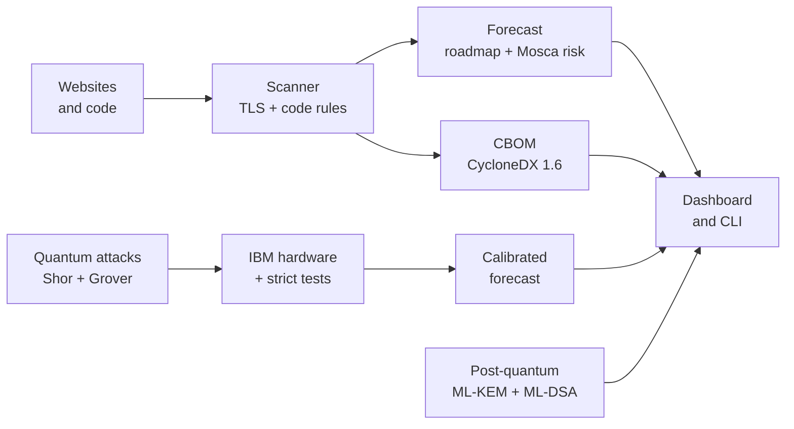
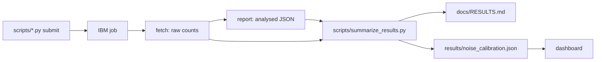

# Q-Day Time Machine — Architecture

How the app is built: the parts, how data flows between them, and why it is designed this way. For using the
app, see [USER_GUIDE.md](USER_GUIDE.md).

## Overview



| Layer | Modules |
| :--- | :--- |
| Scanner | `scanner/tls.py`, `scanner/code.py`, `scanner/cbom.py`, `safety.py`, `catalog.py` |
| Forecast | `forecast/estimates.py`, `forecast/roadmap.py`, `forecast/risk.py`, `forecast/calibrated.py` |
| Quantum | `quantum/shor.py`, `quantum/grover.py`, `quantum/runner.py`, `quantum/stats.py`, `quantum/validation.py`, `quantum/debug.py` |
| Post-quantum | `migrate/pqc.py` |
| Interfaces | `app.py` + `ui.py` (dashboard), `cli.py` (`qday` command), `landing/` (3D page), `serve.py` (one-port server) |

Everything that computes lives in the `qday` package and is plain Python with no UI code, so the dashboard, the
CLI and the tests all call the same functions.

## Components

### Scanning — `qday/scanner/`

| Module | What it does |
| :--- | :--- |
| `tls.py` | Connects with Python `ssl` to read the certificate and issuer key, then runs `openssl s_client` to read the negotiated key-exchange group (including hybrids such as `X25519MLKEM768`) and cipher. Returns a profile and a list of assets. |
| `code.py` | Walks a folder (no symlink following, vendored and build folders skipped, 2 MB per file, 50,000 files) and applies regex rules per language, extracting key sizes and curves where the code states them. |
| `cbom.py` | Turns assets into a CycloneDX 1.6 document: one `cryptographic-asset` per algorithm, with occurrences and `qday:*` properties. |

An **asset** is a plain dict: `algorithm`, `purpose`, `location`, and for websites the host. Every later stage adds
fields to it rather than inventing new types.

`qday/safety.py` validates every hostname (RFC 1123 or an IP literal) and port before anything touches the
network. This matters because hostnames end up as arguments to `openssl`: a "host" of `-proxy evil:8080` is
rejected rather than run.

### Knowledge — `qday/catalog.py`

For each algorithm: its family, primitive (key exchange, signature, encryption, hash), quantum status (`shor`,
`grover`, `classical`, `safe`), size parameter and recommended replacement. One table drives the risk rules, the
CBOM's quantum security level and the fix shown on every card.

### Forecast — `qday/forecast/`

| Module | What it does |
| :--- | :--- |
| `estimates.py` | Published resource costs, each cited: Gidney 2025 (RSA-2048: 1,399 logical qubits, 6.5 × 10⁹ Toffoli), Gidney & Ekerå 2019 (formulas for any RSA size), Roetteler et al. 2017 (elliptic curves). |
| `roadmap.py` | IBM's fault-tolerant roadmap (Starling 2029, Blue Jay 2033+) and two scenarios after 2033: `roadmap` (stop) and `trend` (the Starling→Blue Jay growth rate continues, labelled hypothetical). `first_break_year` is the first year that provides **both** the logical qubits **and** the operations an attack needs. |
| `risk.py` | Mosca's inequality per asset: for data that must stay secret, shelf life + migration time > years to break means **critical**; for signatures, migration time > years to forgery. Also the harvest-now window: which years of recorded traffic become readable while still sensitive. |
| `calibrated.py` | The hardware-calibrated forecast: fits each saved Grover run as ideal output mixed with uniform noise, converts that to an effective error per two-qubit gate, groups runs by physical qubits, and carries the error rate through a surface-code model to the physical qubits RSA-2048 would need. |

### Quantum — `qday/quantum/`

| Module | What it does |
| :--- | :--- |
| `shor.py` | Order finding by quantum phase estimation. The controlled multipliers `x → a^(2^j)·x mod N` are synthesised for any constant: for N = 15 as bit rotations plus NOT (cheap enough for hardware), otherwise as a permutation unitary. Continued fractions and gcd turn measurements into factors. |
| `grover.py` | Key search on a toy cipher `E_k(p) = S(p ⊕ k)` with a nonlinear S-box. The oracle computes the cipher on every key at once, flips the phase of keys that match the known pair, and uncomputes; the diffuser reflects about the mean. |
| `runner.py` | One interface for the ideal simulator (`aer`), noise models (`fake_*`) and IBM machines (`ibm_*`): transpiles for the target and batches circuits into one SamplerV2 job. |
| `stats.py` | Wilson intervals, exact one-sided binomial tests, total variation distance. |
| `validation.py` | The strict, pre-registered pass rules (`strict-v1`): signal, dominance, fidelity, Grover's curve against theory, other placements, repeatability. |
| `debug.py` | quantum-debugger integration: converts circuits exactly (or refuses), re-simulates them as an independent check on Qiskit, and steps through Grover for the dashboard's amplitude view. |

### Migration — `qday/migrate/pqc.py`

A working hybrid handshake (X25519 + ML-KEM-768, keys combined with HKDF into an AES-256-GCM session) and a
signature comparison (RSA-2048, ECDSA P-256, ML-DSA-65) with real sizes, timings and a tampered-message check.

### Interfaces

| File | What it is |
| :--- | :--- |
| `app.py` + `qday/ui.py` | The Streamlit dashboard. `ui.py` holds the theme (the Qiskit Fall Fest design tokens) and small HTML components: cards, notes, tables, the step strip. Expensive work is cached per session (`st.cache_data`). |
| `qday/cli.py` | The `qday` command: `scan`, `cbom`, `forecast`, `shor`, `grover`, `pqc`. Exit codes make it usable as a CI gate. |
| `landing/` | A static page: a three.js tunnel of year rings coloured by what each year's machine can break, GSAP scroll animation and Lenis smooth scrolling. `build.py` wraps the source fragment into `index.html`. |
| `serve.py` | Starts Streamlit on an internal port with base path `/app`, then serves the landing page at `/` and proxies `/app/` (HTTP and the websocket) with aiohttp, so one port serves everything. The Streamlit file watcher is off: it walked every loaded module on each new visit and delayed page loads by ~10 s. |

## Data and results

```text
results/
├── hardware_run.json           first run on ibm_marrakesh (counts per circuit)
├── suite_job_<backend>.json    17-circuit validation suite, one job per machine (+ fake_marrakesh)
├── hardware_suite.json         analysed suite: rates, Wilson intervals, p-values, TVD
├── strict/<backend>_<tag>.json strict suite raw counts with physical qubits and layout
├── hardware_strict.json        analysed strict suite: every rule, per test and per machine
└── noise_calibration.json      measured error rates and the calibrated forecast (generated)
```

Raw counts are saved as they come back from IBM; analysis files are derived from them by the scripts. The
pipeline is:



`summarize_results.py --check` runs in CI and in the tests, so `docs/RESULTS.md` and the calibration file can never
drift from the raw counts.

## Design decisions

| Decision | Why |
| :--- | :--- |
| Qubits **and** operations decide a break year | Machines on the roadmap reach the qubit count for RSA-2048 before they can run enough gates; a qubit-only forecast would be years early. |
| Toffoli counts compared directly with IBM's gate counts | Simple and favours the attacker, so dates lean early, the safe direction for a defender. Stated in the app and README. |
| Multipliers synthesised for any constant | So the Shor circuit never encodes the answer, a common flaw in small Shor demos. |
| Pass rules fixed in code before hardware runs | Removes the temptation to choose criteria after seeing results; Grover secrets were also drawn blind. |
| Two simulators | quantum-debugger checks every attack circuit independently of Qiskit, so the ideal distributions hardware results are scored against do not rest on one simulator. |
| Grover, not Shor, to measure noise | Grover measures every qubit it uses. In Shor N = 15 most gates act on the work register, whose errors barely reach the measured qubits, so its success does not track gate count. |
| Calibrated forecast reported as a ratio | The surface-code model is simpler than the paper's, so it is used for the ratio between our measured error and the paper's assumed one, then scaled from the paper's figure. |
| Nothing scanned until asked; nothing prefilled | Scanning someone else's site by accident is not acceptable; the user must type and press. |
| One port for landing and dashboard | Simple to host behind one domain and one TLS certificate; the proxy carries Streamlit's websocket. |

## Testing

998 tests at 96% line coverage, run in CI on Python 3.11 and 3.12. By kind:

- **Exhaustive:** every modular multiplier on every input; Shor for every base of 15 and 21; Grover for every key
  against the sin² law.
- **Property-based (Hypothesis):** factors multiply to N, recovered periods are real periods, intervals contain
  the rate.
- **Golden:** every hardware number in the README and `docs/RESULTS.md` recomputed from raw counts.
- **Integration:** real TLS handshakes against a local server with five certificate types; the one-port server
  with a fake dashboard (websockets, large messages, dashboard down).
- **End to end:** the dashboard driven headlessly with Streamlit's AppTest.
- **Security:** hostile hostnames, binary and huge files, symlink loops.

Network tests (`-m network`) and hardware runs (`-m hardware`) are opt-in. CI also lints with ruff (including
security rules), checks that the CLI flags the sample app, checks the results document is current, and scans the
history for live credentials.
